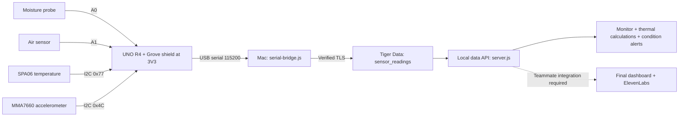

# Current demo hardware wiring and data path

This is the connection map for the tested Arduino setup, not a PCB schematic.
Power the Arduino off before changing wiring. Use the Grove shield at **3V3**.

| Component | Connection on Grove shield | Firmware input |
|---|---|---|
| Grove moisture v1.4 | A0 Grove socket | A0 analog signal |
| Grove air-quality sensor | A1 Grove socket | A1 analog signal |
| Grove SPA06-003 temperature/barometer | I²C Grove socket | SDA A4, SCL A5; address 0x77 |
| Grove MMA7660FC 3-axis accelerometer v1.3 | Another I²C Grove socket | Same SDA/SCL bus; address 0x4C |
| Arduino UNO R4 WiFi | USB data cable to the Mac | Serial at 115200 baud |

The I²C sockets share the same bus. The sensors have different addresses.
Use matching Grove cables and the printed GND/VCC/SDA/SCL labels rather than
guessing pin order from cable colors. Leave accelerometer INT unconnected.
Firmware uses open-drain software I²C on A4/A5 and avoids enabling 5V internal
pull-ups. Do not substitute standard bus code without checking voltage behavior.

Mount the accelerometer firmly on the fridge/cart body with an insulated mount.
Keep the Arduino, connectors and exposed electronics dry. The moisture probe
needs physical wet contact; it does not measure humidity. The demo currently
requires the Mac and USB connection; wireless sensor upload is not implemented.

Upload `fridge_all_sensors/fridge_all_sensors.ino`. Run the sensor task in
`FOODBANK.code-workspace`; leave Arduino Serial Monitor closed while it runs.
Use the web monitor to watch readings without taking the serial port away.
Saleh's private configuration records approximately one row per second.

The Logitech webcam connects directly to a computer's USB port, not the Arduino.
The Mac camera, Gemini/barcode identification and JBL/ElevenLabs audio are
separate teammate modules; the sensor firmware does not control them.

Database schema: `../tiger-data/migrations/001_fridge.sql`.
Startup/storage instructions: `../tiger-data/README.md`.
Thermal API: `../tiger-data/MATH-HANDOFF.md`.
Alert integration/calibration: `../tiger-data/CONDITION-ALERTS-HANDOFF.md`.
Private credentials must be provisioned separately. Recorded data lives in
Tiger Data, not in this Git repository.
